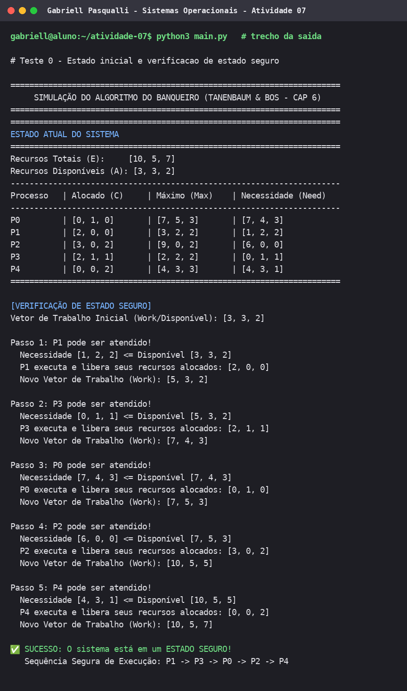
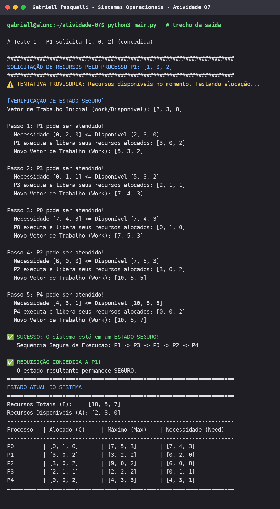
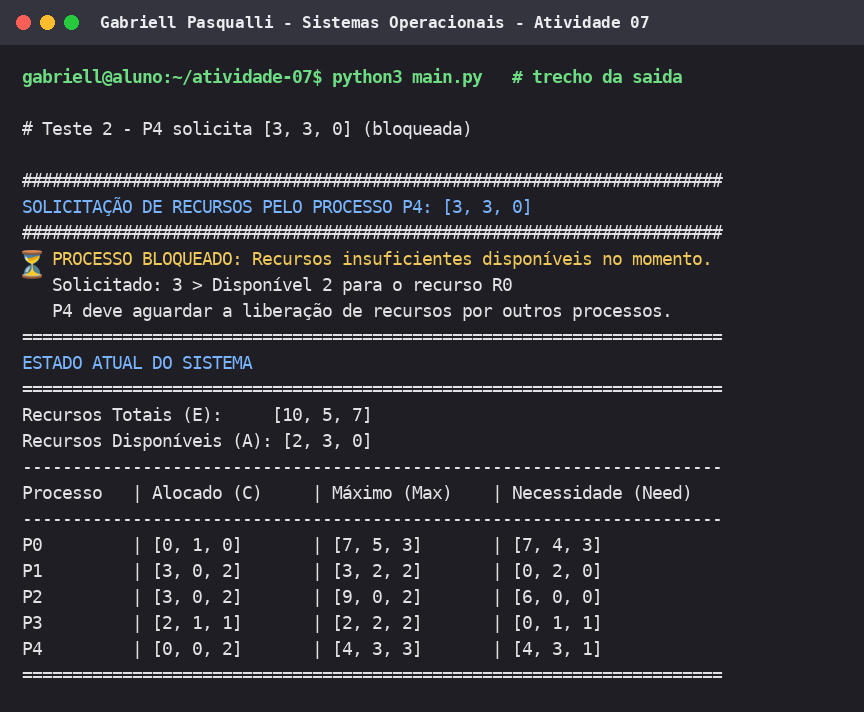

# Atividade 07 — Algoritmo do Banqueiro

**Aluno:** Gabriell Pasqualli
**Disciplina:** Sistemas Operacionais
**Assunto:** Prevenção de deadlock com o Algoritmo do Banqueiro (Tanenbaum & Bos, cap. 6)

Este diretório reúne a evidência da execução do `main.py`: a explicação de cada teste, a saída gerada e o print de cada execução (com o nome do aluno na barra de título).

## Estrutura

```
atividade-07/
├── main.py                  # implementação do Algoritmo do Banqueiro (sem alterações)
├── gerar_prints.py          # executa o main.py, separa a saída por teste e gera os prints
├── README.md                # este arquivo
├── saidas/                  # saída textual da execução
│   ├── saida_completa.txt
│   ├── teste_00_estado_inicial.txt
│   ├── teste_01_p1_requisicao_segura.txt
│   └── teste_02_p4_requisicao_bloqueada.txt
└── prints/                  # um print por teste
    ├── teste_00_estado_inicial.png
    ├── teste_01_p1_requisicao_segura.png
    └── teste_02_p4_requisicao_bloqueada.png
```

Para reproduzir: `python3 main.py` (ou `python3 gerar_prints.py` para regenerar saídas e prints).

## Cenário simulado

5 processos (P0 a P4) e 3 tipos de recursos (R0, R1, R2).

**Recursos totais (E):** `[10, 5, 7]`

| Processo | Alocado (C) | Máximo (Max) | Necessidade (Need = Max − C) |
|----------|-------------|--------------|------------------------------|
| P0 | [0, 1, 0] | [7, 5, 3] | [7, 4, 3] |
| P1 | [2, 0, 0] | [3, 2, 2] | [1, 2, 2] |
| P2 | [3, 0, 2] | [9, 0, 2] | [6, 0, 0] |
| P3 | [2, 1, 1] | [2, 2, 2] | [0, 1, 1] |
| P4 | [0, 0, 2] | [4, 3, 3] | [4, 3, 1] |

**Disponíveis (A = E − soma de C):**
R0 = 10 − (0+2+3+2+0) = 3, R1 = 5 − (1+0+0+1+0) = 3, R2 = 7 − (0+0+2+1+2) = 2, ou seja, `A = [3, 3, 2]`.

---

## Teste 0 — Estado inicial e verificação de estado seguro

**O que é testado:** se o sistema, antes de qualquer requisição, está em um estado seguro, isto é, se existe uma ordem de execução em que todos os processos conseguem terminar.

**Como o algoritmo decide:** parte de `Work = A = [3, 3, 2]` e procura um processo não finalizado com `Need <= Work`. Quando encontra, o processo "executa" e devolve seus recursos alocados a `Work`. Repete até terminar todos ou até não haver candidato.

| Passo | Processo | Need | Work antes | Work depois |
|-------|----------|------|------------|-------------|
| 1 | P1 | [1, 2, 2] | [3, 3, 2] | [5, 3, 2] |
| 2 | P3 | [0, 1, 1] | [5, 3, 2] | [7, 4, 3] |
| 3 | P0 | [7, 4, 3] | [7, 4, 3] | [7, 5, 3] |
| 4 | P2 | [6, 0, 0] | [7, 5, 3] | [10, 5, 5] |
| 5 | P4 | [4, 3, 1] | [10, 5, 5] | [10, 5, 7] |

**Resultado:** ✅ estado **SEGURO**. Sequência segura: **P1 → P3 → P0 → P2 → P4**. Ao final, `Work = [10, 5, 7]`, igual a `E`, o que confirma que todos os recursos foram devolvidos.

**Print:** 
**Saída:** [`saidas/teste_00_estado_inicial.txt`](saidas/teste_00_estado_inicial.txt)

---

## Teste 1 — P1 solicita [1, 0, 2] (requisição válida e segura)

**O que é testado:** uma requisição que respeita a necessidade máxima, cabe nos recursos disponíveis e mantém o sistema seguro.

**Passos do algoritmo:**
1. `Request <= Need[P1]`: [1, 0, 2] ≤ [1, 2, 2] ✔
2. `Request <= Available`: [1, 0, 2] ≤ [3, 3, 2] ✔
3. Alocação provisória: `A = [2, 3, 0]`, `C[P1] = [3, 0, 2]`, `Need[P1] = [0, 2, 0]`.
4. Verificação de estado seguro a partir de `Work = [2, 3, 0]`: P1 → P3 → P0 → P2 → P4, todos atendidos.

**Resultado:** ✅ **REQUISIÇÃO CONCEDIDA**. O estado resultante continua seguro, e a alocação é mantida. Estado após o teste: `A = [2, 3, 0]`, P1 com `C = [3, 0, 2]` e `Need = [0, 2, 0]`.

**Print:** 
**Saída:** [`saidas/teste_01_p1_requisicao_segura.txt`](saidas/teste_01_p1_requisicao_segura.txt)

---

## Teste 2 — P4 solicita [3, 3, 0] (requisição bloqueada)

**O que é testado:** uma requisição que respeita a necessidade máxima do processo, mas não pode ser atendida com o que há disponível.

**Passos do algoritmo** (estado já alterado pelo Teste 1, com `A = [2, 3, 0]`):
1. `Request <= Need[P4]`: [3, 3, 0] ≤ [4, 3, 1] ✔
2. `Request <= Available`: [3, 3, 0] vs [2, 3, 0] ✘. O processo pede 3 unidades de R0 e só há 2.

**Resultado:** ⏳ **PROCESSO BLOQUEADO**. A requisição falha no passo 2, antes de qualquer alocação provisória. Por isso **não há teste de estado seguro nem rollback**, e o estado do sistema permanece idêntico ao do fim do Teste 1. P4 deve aguardar a liberação de recursos.

> **Observação:** o comentário no `main.py` descreve este caso como "requisição INSEGURA". Na execução real, o caso é barrado pela checagem de disponibilidade (passo 2), e não pela verificação de segurança (passo 4). A saída acima reflete o comportamento real do código.

**Print:** 
**Saída:** [`saidas/teste_02_p4_requisicao_bloqueada.txt`](saidas/teste_02_p4_requisicao_bloqueada.txt)

---

## Resumo

| Teste | Requisição | Resultado |
|-------|-----------|-----------|
| 0 | — (estado inicial) | Estado seguro: P1 → P3 → P0 → P2 → P4 |
| 1 | P1 pede [1, 0, 2] | Concedida (estado permanece seguro) |
| 2 | P4 pede [3, 3, 0] | Bloqueada (R0: pede 3, disponível 2) |

## Sobre os prints

Os prints são imagens de terminal geradas pelo `gerar_prints.py` a partir da saída real do `main.py`, com o nome do aluno na barra de título e no prompt. Se o professor exigir capturas de tela do terminal, rode `python3 main.py` no seu computador, tire a captura com seu nome visível (por exemplo, no prompt ou no título da janela) e substitua os arquivos da pasta `prints/`.
